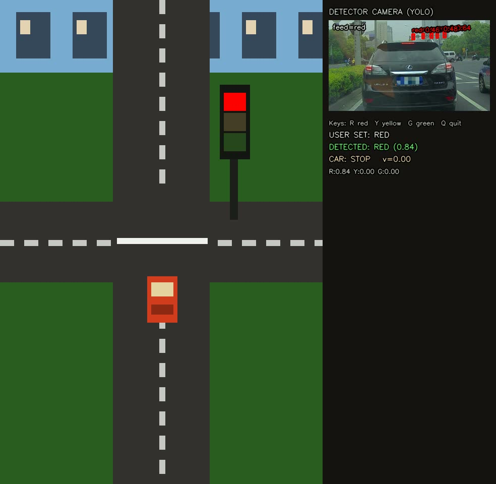
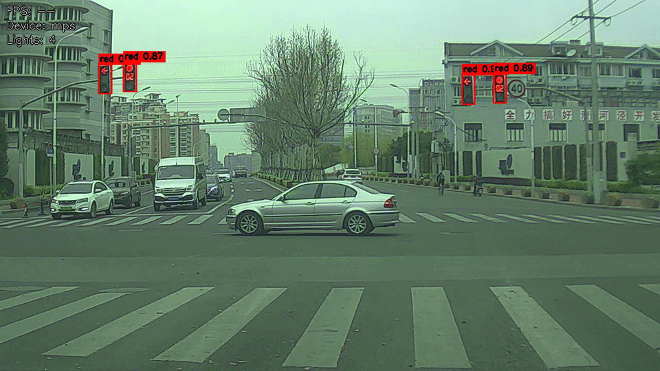

# Traffic Light Detection System

Custom YOLOv8 traffic-light detector (`red` / `yellow` / `green` / `off`) with OpenCV streaming, CUDA acceleration, baseline comparison, ONNX/TensorRT export, Docker (x86 + Jetson), and GitHub Actions CI/CD.

## Demo

### Detector-driven pixel game

[](https://github.com/NayanY176/Traffic-Light-Simulation/raw/main/docs/demo_game.mp4)

[Watch demo_game.mp4](https://github.com/NayanY176/Traffic-Light-Simulation/raw/main/docs/demo_game.mp4)

### Sample image detections



[Preview still](docs/demo_preview.jpg) · [Watch demo.mp4 (H.264)](https://github.com/NayanY176/Traffic-Light-Simulation/raw/main/docs/demo.mp4)

## Stack

Python · PyTorch · OpenCV · Ultralytics YOLOv8 · Docker · CUDA

## Dataset (real)

Primary source: [Hugging Face — `lincolnn2026/traffic_light_dataset`](https://huggingface.co/datasets/lincolnn2026/traffic_light_dataset)

- Real dashcam / street frames at **1280×720**
- YOLO labels already present; remapped to:

| ID | Name |
| -- | ---- |
| 0 | red |
| 1 | yellow |
| 2 | green |
| 3 | off |

Default download pulls a disk-friendly subset (`250` train / `50` val / `30` test). Increase counts when you have space:

```bash
python scripts/download_dataset.py --train-count 800 --val-count 100 --test-count 100
```

Roboflow fallback (optional API key): `--provider roboflow` with `ROBOFLOW_API_KEY`.

## Setup

```bash
python3 -m venv .venv
source .venv/bin/activate
pip install -r requirements.txt
export PYTHONPATH=.
```

Or: `make setup`

## Step-by-step

### 1) Download real data + prepare YOLO splits

```bash
make dataset
make prepare
ls data/processed/traffic_lights/images/train | head
ls samples/
```

### 2) Train custom YOLOv8

```bash
make train
# or
python scripts/train.py --model yolov8n.pt --epochs 50 --imgsz 960 --batch 8 --device 0
cp runs/detect/traffic_lights_yolov8/weights/best.pt weights/best.pt
```

### 3) Evaluate

```bash
python scripts/evaluate.py --weights weights/best.pt --data data/processed/traffic_lights/data.yaml
```

Writes measured metrics to `outputs/eval/` (no invented numbers).

### 4) Baseline comparison

YOLOv5s + YOLOv8s vs custom, plus Faster R-CNN ResNet50 smoke forward:

```bash
make baselines
cat outputs/eval/summary.json
```

### 5) Pixel driving demo (YOLO-controlled)

Mini pixel game + real camera feeds. **You set the light** (`R` / `Y` / `G`); the **trained detector** (`weights/best.pt`) reads the feed; the car reacts to the **detected** state (stop on red, go on green, keep going on yellow if already in the intersection).

```bash
# play — press R / Y / G to change the light, Q to quit
python scripts/demo_game.py --weights weights/best.pt

# record a scripted clip for GitHub
python scripts/demo_game.py --weights weights/best.pt --no-show \
  --auto green:4,yellow:2,red:4,green:4 --duration 14 \
  --record docs/demo_game.mp4
```

### 6) Real-time inference

```bash
python scripts/infer.py --weights weights/best.pt --source samples --no-show --save outputs/infer
python scripts/infer.py --weights weights/best.pt --source 0 --show
python scripts/infer.py --weights weights/best.pt --source path/to/video.mp4 --save outputs/out.mp4
```

### 7) Benchmark (1080p, warmup + CUDA sync)

```bash
python scripts/benchmark.py --weights weights/best.pt --backend pytorch --width 1920 --height 1080
python scripts/benchmark.py --weights weights/best.pt --backend all --include-tensorrt
```

### 8) Export

```bash
python scripts/export_model.py --weights weights/best.pt --format both --device 0
```

## Docker

```bash
docker build -f docker/Dockerfile --target infer -t traffic-light-detect:infer .
docker compose -f docker/docker-compose.yml run --rm infer
docker compose -f docker/docker-compose.yml run --rm train
docker build -f docker/Dockerfile.jetson -t traffic-light-detect:jetson .
```

## Tests / CI

```bash
make test
make lint
make typecheck
```

GitHub Actions: ruff → mypy → pytest → Docker build → container smoke inference. Tagged releases push to GHCR.

## Results

Measured on this machine from `outputs/eval` / `outputs/eval_baseline` / `outputs/benchmark` (HF subset: **250** train / **50** val / **30** test; Apple M3 CPU):

| Model | Epochs | mAP@0.5 | mAP@0.5:0.95 | Precision | Recall | FPS (1280×720, imgsz=640) |
| ----- | -----: | ------: | -----------: | --------: | -----: | ------------------------: |
| Custom YOLOv8n | 25 | 0.433 | 0.204 | 0.940 | 0.365 | 33.8 (CPU) |
| YOLOv5s baseline | 12 | 0.465 | 0.236 | 0.912 | 0.408 | — |

Relative mAP@0.5 (custom vs YOLOv5s): **-6.9%** (see `outputs/eval/summary.json`). Nano custom trails the larger YOLOv5s baseline on this small test split; precision is higher on custom.

Per-class AP@0.5 (custom): red **0.694**, green **0.605**, yellow **0.000** (rare in subset).

## Layout

```
configs/   dataset + train + hyp
src/       data, train, evaluate, baselines, inference, benchmark, export
scripts/   CLI entry points
tests/     pytest
docker/    CUDA Dockerfile, Jetson Dockerfile, compose
.github/workflows/ci.yml
```
